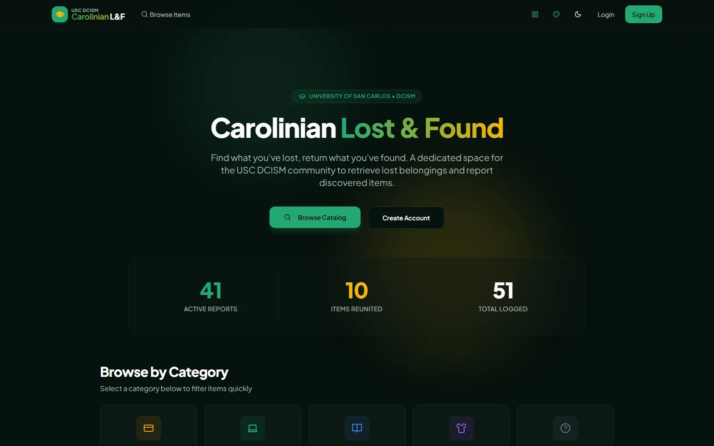
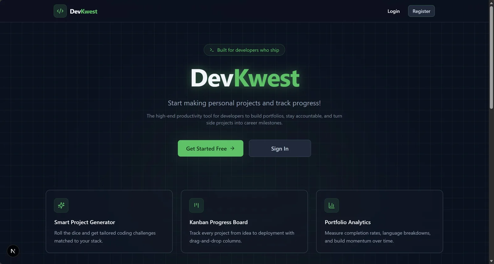

# Gregg Alexander Marayan

**Full Stack Developer** · Taguig City, Metro Manila, Philippines · Available for remote work

> I build web apps that are fast, accessible and secure.

Information Technology graduate from the University of San Carlos with hands-on experience in full-stack web development, networking and cybersecurity.

[Portfolio](https://greggmarayan.me) · [GitHub](https://github.com/GRONK13) · [LinkedIn](https://www.linkedin.com/in/gregg-marayan) · [Email](mailto:gregg.marayan@gmail.com) · [Résumé (PDF)](https://greggmarayan.me/gregg-marayan-resume.pdf)

## About

My journey began in a Senior High School robotics class, tinkering with microcontrollers and basic programming. That hands-on experience sparked the curiosity that led me to study Information Technology.

Since then I've grown through projects, coursework, an internship and community work with Google Developer Groups on Campus. I enjoy helping teams turn ideas into working software, whether that's chasing down a backend bug, refining a UI component or setting up a smoother team workflow.

Away from the keyboard you'll find me playing Tekken 8 and Surroundead, watching shows like Dexter, or trying out new frameworks and dev tools.

### How I work

- **Clean code**: Maintainable, scalable, self-documenting code with rigorous types.
- **Innovation**: Creative engineering solutions to real-world, complex workflows.
- **Collaboration**: Working effectively with multidisciplinary teams using Agile methods.
- **Performance**: Optimizing page loads, rendering paths and database calls.

## Now

Updated Oct 19, 2026

- **Building:** Version 5 of this portfolio, with an editable content system
- **Exploring:** Cloud tooling, system administration and security operations
- **Looking for:** Remote full-stack or software developer roles

## Selected work

### Carolinian Lost & Found

Campus portal for reporting found items and recovering lost belongings.

**Built with:** Next.js, Supabase, JavaScript, Tailwind CSS

[Live site](https://lost-n-found.dcism.org/) · [Source](https://github.com/GRONK13/lost-and-found) · [Case study](https://greggmarayan.me/work/lost-and-found)

### J&A Car Rental System

Mobile-first booking and management system for a real car rental business.

**Built with:** React, Express.js, Prisma, PostgreSQL, JavaScript, Tailwind CSS

[Live site](https://ja-car-rental-system.vercel.app/) · [Source](https://github.com/unclejambo/JA-car-rental-system) · [Case study](https://greggmarayan.me/work/ja-car-rental)

### DevKwest

A platform for developers to level up by building new projects.

**Built with:** Next.js, TypeScript, Supabase, Tailwind CSS, Framer Motion

[Live site](https://devkwest.vercel.app) · [Source](https://github.com/nzrnshannen/devkwest) · [Case study](https://greggmarayan.me/work/devkwest)

## Experience & education

### Work

- **Software Developer Intern**, Talleco JobTarget · Oct 2025 – Mar 2026  
  Developed and maintained web applications using modern technologies.

### Education

- **BS Information Technology**, University of San Carlos · 2021 – 2026  
  Algorithms, data structures, networking and web development fundamentals.
  - Internal Relations Officer, GDGoC USC Talamban (2025)
  - Deployed a personal portfolio with Next.js and Vercel
  - Used Supabase for backend storage and team workflows
  - Built a to-do app with React and Capacitor
- **High School Diploma, STEM**, Sacred Heart School – Ateneo de Cebu · 2015 – 2021  
  Science, technology, engineering and math with hands-on research projects.
  - Built a first portfolio with HTML, CSS and JavaScript (2017)
  - Learned C programming fundamentals (2020)
- **Elementary Education**, San Roque College de Cebu · 2009 – 2015  
  Foundational education in mathematics, science and language arts.
  - Math Wizard Award (2015)

## Certifications

- **NSE 1 Certified in Cybersecurity**, Fortinet · Oct 1, 2026 (valid until Oct 1, 2028) · [Verify](https://www.credly.com/badges/c3463ca6-ab89-4340-9194-4e58c3aebf9e/public_url)
- **Cybersecurity and Cloud Fundamentals 1.0**, Fortinet · Oct 1, 2026 · [Verify](https://www.credly.com/badges/688ac788-ac4d-4731-96a5-a04853fa59c8/public_url)
- **CyberOps Associate**, Cisco · Oct 22, 2024 · [Verify](https://www.credly.com/badges/716ca1da-5f9a-451a-876b-ac68e5f8e7a4/public_url)
- **Introduction to Cybersecurity**, Cisco · Aug 30, 2024 · [Verify](https://www.credly.com/badges/47bc0d42-b5bd-42b3-b1e5-a198b3993aa5/public_url)

## Skills

- **Daily drivers** (what I reach for first): TypeScript, React, Next.js, Tailwind CSS, Git, VS Code
- **Comfortable** (used on shipped projects): JavaScript, Node.js, Express.js, PostgreSQL, Prisma, Supabase, REST APIs, Vercel, Framer Motion, Postman, Figma
- **Exploring** (growing into): C# / ASP.NET Core, Docker, GitHub Actions, GraphQL, Security monitoring, Network intrusion analysis

## Contact

The fastest way to reach me is email: [gregg.marayan@gmail.com](mailto:gregg.marayan@gmail.com), or the contact form on [my portfolio](https://greggmarayan.me/#contact).

---

This README is generated from the portfolio's content (`content/`) by `pnpm readme`. To change it, edit the content files, not this README. For the codebase itself, see [docs/development.md](docs/development.md).
